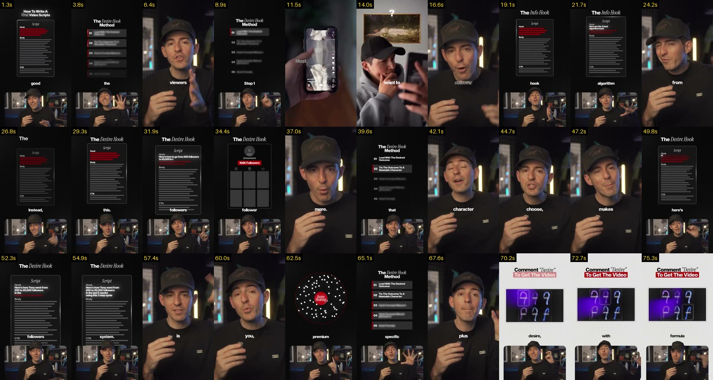
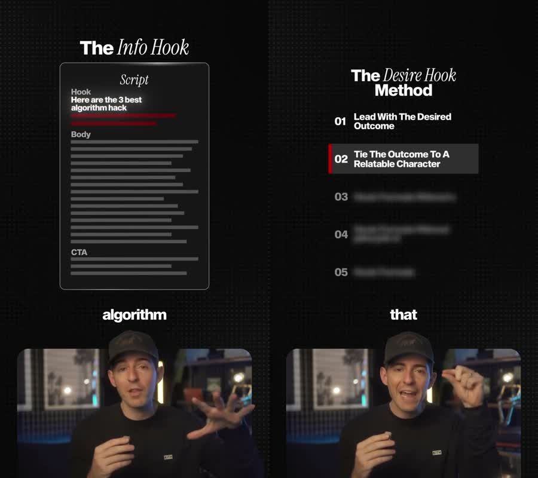

# How to write viral video scripts (English, 77 s, 720x1280)

Source video: `learn/done/3935263589509299675.mp4` (kept on the owner's PC, not in git: other creators' content, ~6.9 MB).

## Pacing
- 17 shots, avg 4.5 s; alternates full frame and a pop-out window every ~4–5 s

## Learned
- Pop-out window: speaker in a rounded bottom window, head top breaking out above the edge, tall dark dotted canvas above (became the v4 window)
- Script / list cards on the dark canvas: glassy card, bold sans + italic serif title, red accents, blurred upcoming list items
- Single-word captions between canvas and window; light CTA card at the end

Recipes: `.claude/skills/pro-edit/styles.md`. Log: `learn/LOG.md`.

## Sheets
- 
- 
