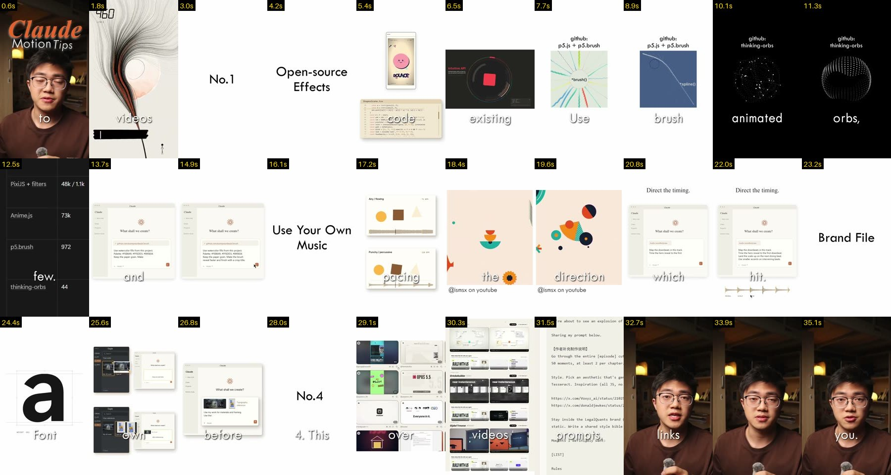

# Claude Motion Tips (English, 35 s, 720x1280)

Source video: `learn/done/4001236891292805512.mp4` (kept on the owner's PC, not in git: other creators' content, ~3.4 MB).

## Pacing
- 20 shots, avg 1.8 s; white cards + one-word captions; music-led pacing (108 BPM, downbeats every ~2.2 s)

## Learned
- Build effects on open-source libraries (p5.js + p5.brush, PixiJS filters, Anime.js, particle orbs)
- Music sets pacing: land the big move on a downbeat, small accents on the beats between → pro-edit/beats.py
- Keep a brand file (colour, font, motion) + references before starting
- Recipe: numbered chapter card

Recipes: `.claude/skills/pro-edit/styles.md`. Log: `learn/LOG.md`.

## Sheets
- 

Transcript (Whisper, phrase-level): [transcript.md](transcript.md)
