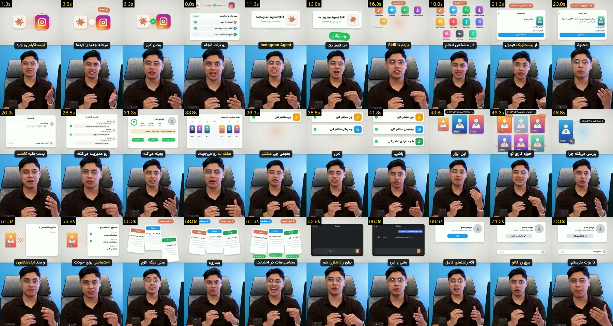
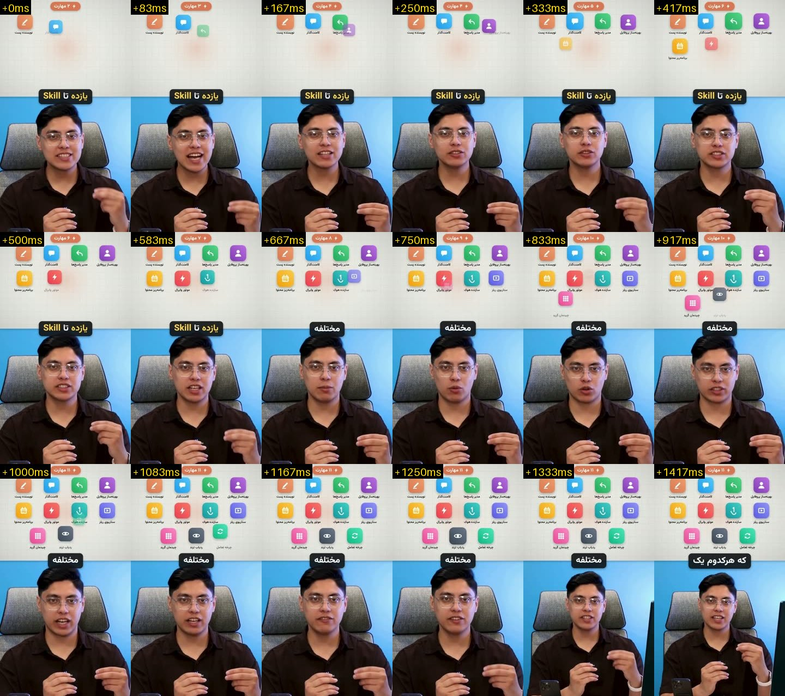

# Same script as project one by another creator (Persian, 75 s, 720x1280)

Source video: `learn/done/4009793604077813282.mp4` (kept on the owner's PC, not in git: other creators' content, ~10.1 MB).

## Pacing
- 3 shots, avg 25 s; split explainer: UI-mock panel on top, speaker below, a new illustration every ~2.5 s

## Learned
- Split explainer layout (became v3, then the panel of the owner's preferred v4 layout)
- One UI-mock illustration per sentence, mapped 1:1 to the script (16 → 18 scenes in templates/split-explainer)
- Staggered icon grid: one icon every ~83 ms with a live counter tag (measured with a 12 fps strip)
- Boxed seam captions; with a visual per item the full 75 s list holds attention
- Confirmed «هر روز» (not «سه روز») in the owner's script

Recipes: `.claude/skills/pro-edit/styles.md`. Log: `learn/LOG.md`.

## Sheets
- 
- 

Transcript (Whisper, phrase-level): [transcript.md](transcript.md)
