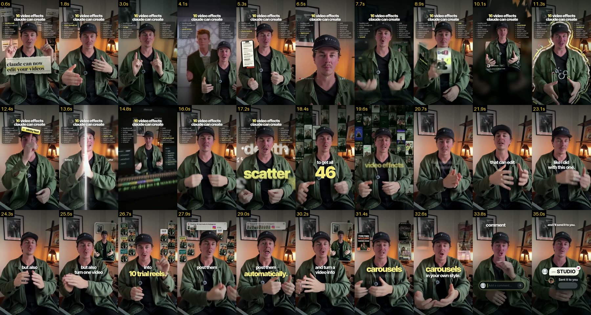

# 16 video effects Claude can create (English, 35 s, 720x1280)

Source video: `learn/done/4012950191610839212.mp4` (kept on the owner's PC, not in git: other creators' content, ~6.5 MB).

## Pacing
- 14 shots, avg 2.5 s; a new effect every 1–2 s; persistent list HUD

## Learned
- List HUD with the spoken item highlighted
- Emphasis captions: small white lead-in + big yellow keyword (became the owner's default)
- Big number with lead-in; word behind the speaker; Instagram comment-box CTA
- Effect catalogue: headline wall, green screen, phone mockup, digital zoom, UI world, frame break, doodle boil, sticky text, before/after, pullback reveal, orbit

Recipes: `.claude/skills/pro-edit/styles.md`. Log: `learn/LOG.md`.

## Sheets
- 

Transcript (Whisper, phrase-level): [transcript.md](transcript.md)
